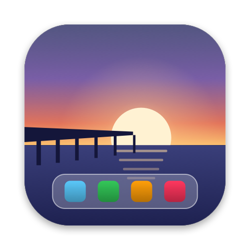

# Pier

A replacement for the macOS Dock that you can actually customize. Native Swift and AppKit, no Electron.

<p align="center"></p>

The built-in Dock lets you change its size, position and magnification. Pier lets you change everything else:

- App folders. Drag one app onto another to make a folder, then rename it, reorder it, or ungroup it.
- Notification badges, mirrored from the macOS Dock.
- Widgets that live in the dock: clock, Now Playing (Music and Spotify) with playback controls, weather and battery.
- Window previews. Hover a running app to see live thumbnails of its windows, then click one to jump to it or close it from the card.
- Custom icons for any app.
- Click actions you choose for click, ⌥-click, ⌘-click, ⇧-click, middle-click and scroll up or down: hide, cycle windows, new window, App Exposé, quit, and more.
- Drag files onto an app to open them with it. Drag files onto the Trash to throw them away.
- Stacks for folders like Downloads, with Quick Look thumbnails. Drag items straight out of them.
- Themes. Liquid Glass (macOS 26+), frosted blur or solid backgrounds, with tint, roundness, borders, shadow, sizes and indicator style all adjustable. Themes are small `.piertheme` files you can share; double-click one to install it.
- Bottom, left or right placement, auto-hide, magnification that keeps the icon under your pointer still, and multi-display follow-the-pointer.

On first launch Pier copies the layout of your current macOS Dock, so nothing needs setting up.

## Install

Requires macOS 14 or later. Liquid Glass needs macOS 26 or later; older versions get a frosted blur.

```bash
git clone https://github.com/<you>/Pier.git
cd Pier
scripts/build_app.sh --install
```

That builds a release binary, wraps it in `Pier.app`, signs it with the first Developer ID or Apple Development identity in your keychain (or ad-hoc if you have none), copies it to `/Applications` and launches it.

To hide the macOS Dock, use the menu bar icon or Settings → General. Pier turns on the system Dock's auto-hide with a very long delay, and turns it back off when you uncheck the option or quit Pier.

## Permissions

Pier works without any permissions. Two optional ones add features:

| Permission | Enables |
|---|---|
| Accessibility | Badges, window lists in menus, focusing a specific window, ⌘N / minimize / cycle click actions |
| Screen Recording | Live thumbnails in window previews (window titles still show without it) |

macOS will also ask once before Pier reads Music or Spotify, and before it uses your location (only if you choose location-based weather). Weather comes from [Open-Meteo](https://open-meteo.com), which needs no account. Spotify album art is the only other network request.

If you build Pier yourself with ad-hoc signing, macOS forgets the grants every rebuild. Sign with a stable identity, or set `PIER_SIGN_IDENTITY`.

## Themes

Right-click the dock → Theme to switch. Edit the current one live in Settings → Appearance, then **Save as Theme…** or **Export…**. A theme is plain JSON:

```json
{
  "name": "Prairie",
  "author": "you",
  "background": "liquidGlass",
  "tint": "#F4E7DA",
  "tintOpacity": 0.32,
  "cornerRadius": 0.3,
  "iconSize": 54,
  "indicator": "dot",
  "textColor": "auto"
}
```

Missing keys fall back to defaults and out-of-range values are clamped, so a theme from an older or newer Pier still loads. More examples live in [`themes/`](themes). Pull requests with new themes are welcome.

## How it works

| Piece | File |
|---|---|
| Borderless, non-activating panel at Dock window level. Transparent pixels pass clicks through, so the window can span the screen edge without blocking anything | `Dock/DockWindow.swift` |
| Pure layout engine: frames, Apple-style magnification, auto-fit, hit testing, drop targets | `Layout/DockLayoutEngine.swift` |
| AppKit overlay that owns every click, scroll, menu and drag, drawn over a SwiftUI renderer | `Dock/DockInteractionView.swift`, `Dock/DockView.swift` |
| Pointer polled at 60 Hz in common run-loop modes, so magnification and auto-hide also work mid-drag | `Dock/DockController.swift` |
| Badges read from the system Dock's accessibility tree (`AXStatusLabel`) | `Services/BadgeService.swift` |
| Window lists via Accessibility, thumbnails via ScreenCaptureKit | `Services/WindowService.swift` |
| Layout edits as pure functions over value types, all unit tested | `Model/DockLayout+Editing.swift` |

State lives in `~/Library/Application Support/Pier/` (`layout.json`, `settings.json`, `theme.json`, `Themes/`, `Icons/`).

## Develop

```bash
swift build          # debug build
swift test           # 26 unit tests
scripts/build_app.sh --icon   # re-render the icon from Tools/make_icon.swift
```

The app icon is drawn in code by `Tools/make_icon.swift`, so the repo needs no design files.

## Known limits

- Pier stays out of full-screen Spaces, the same as most dock replacements.
- Maximized windows don't know about Pier, so they can extend underneath it. Auto-hide avoids this.
- Now Playing supports Music and Spotify. macOS 15.4 and later block other apps from reading the system-wide now-playing info.

## License

MIT. See [LICENSE](LICENSE).
